<picture>
  <source media="(prefers-color-scheme: dark)" srcset="assets/header-dark.svg">
  
</picture>

Hey, I'm Lean. I'm 20, I study Business and Entrepreneurship at CODE University in Berlin, and I build pretty much everything with Claude, MCP and agents. A lot of it starts late at night with "wait, could this actually work?" and some of it really ships. On Instagram and TikTok I show how these builds work, including the parts that break.

 

<picture>
  <source media="(prefers-color-scheme: dark)" srcset="assets/title-building-dark.svg">
  
</picture>

<picture>
  <source media="(prefers-color-scheme: dark)" srcset="assets/build-company-dark.svg">
  
</picture>

A company of 16 agents, and not a single one of them is a human. A supervisor hands out the work, the others write, design, make videos and do research, and one of them checks everything before it ever reaches me. I talk to the whole thing through a cockpit with voice input. Honestly, it doesn't all run smoothly yet. Some texts still sound way too much like AI, and that's what I'm fixing right now.

<picture>
  <source media="(prefers-color-scheme: dark)" srcset="assets/build-roblox-dark.svg">
  
</picture>

I make Roblox games where Claude writes most of the Luau code and I decide what's actually fun. **Paket Chaos**, a delivery tycoon, is live. **Catch a Meteor** and **Iron Doctrine**, a strategy game, are still private while I keep building. What I keep learning is that a game that works is still pretty far from a game people want to come back to tomorrow.

<picture>
  <source media="(prefers-color-scheme: dark)" srcset="assets/build-motion-dark.svg">
  
</picture>

My motion graphics for Lean Builds AI start as HTML scenes and get rendered into video with HyperFrames. Claude writes the scenes, I give the direction and say when something looks off, which happens more often than you'd think. This page works the same way, every animation here is an SVG that came out of a script.

<picture>
  <source media="(prefers-color-scheme: dark)" srcset="assets/build-repwing-dark.svg">
  
</picture>

At uni I'm building Repwing with my team. It's an AI assistant for people who sell SaaS, and it's still early, so there isn't much to show here yet.

 

<picture>
  <source media="(prefers-color-scheme: dark)" srcset="assets/title-stack-dark.svg">
  
</picture>

<picture>
  <source media="(prefers-color-scheme: dark)" srcset="assets/stack-dark.svg">
  
</picture>

 

<picture>
  <source media="(prefers-color-scheme: dark)" srcset="assets/title-channels-dark.svg">
  
</picture>

Builds, tool tests and the stuff that went wrong go on Instagram and TikTok as Lean Builds AI. The longer thoughts end up on LinkedIn.

  <a href="https://www.instagram.com/lean.ai.space/"><picture><source media="(prefers-color-scheme: dark)" srcset="assets/btn-instagram-dark.svg"></picture></a>
  <a href="https://www.tiktok.com/@leanbuildsai"><picture><source media="(prefers-color-scheme: dark)" srcset="assets/btn-tiktok-dark.svg"></picture></a>
  <a href="https://www.linkedin.com/in/lean-zuschlag-09a5ab281/"><picture><source media="(prefers-color-scheme: dark)" srcset="assets/btn-linkedin-dark.svg"></picture></a>

 

<picture>
  <source media="(prefers-color-scheme: dark)" srcset="assets/footer-dark.svg">
  
</picture>

Everything on this page was made with Claude, the animations included. If you're building something with agents too, I'd love to see it.

